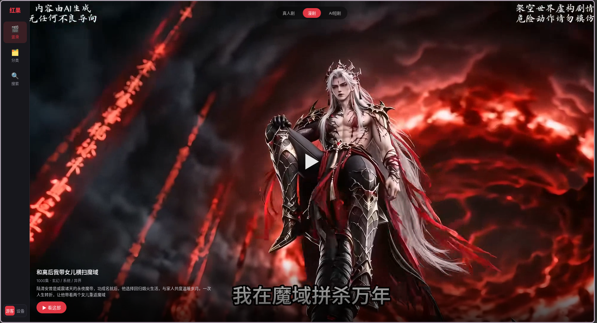
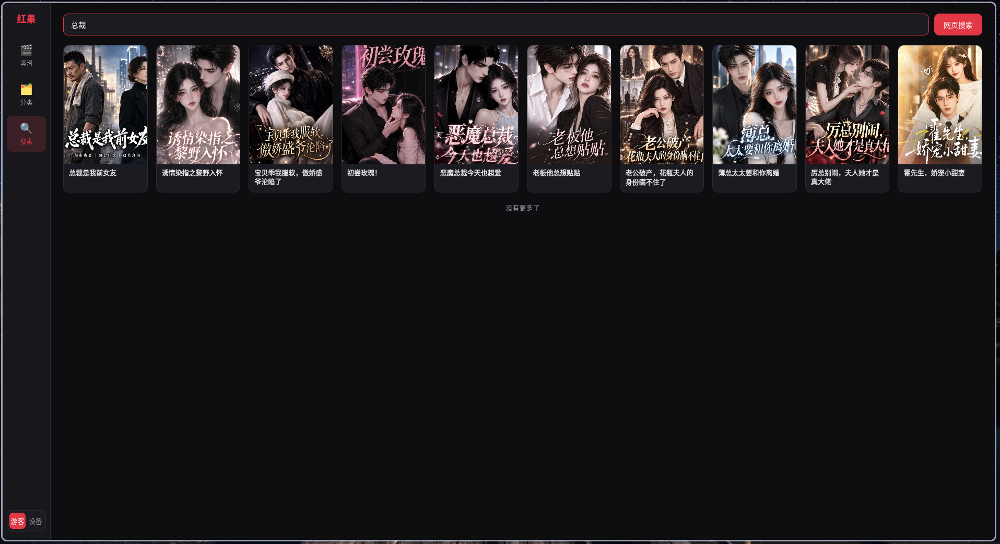
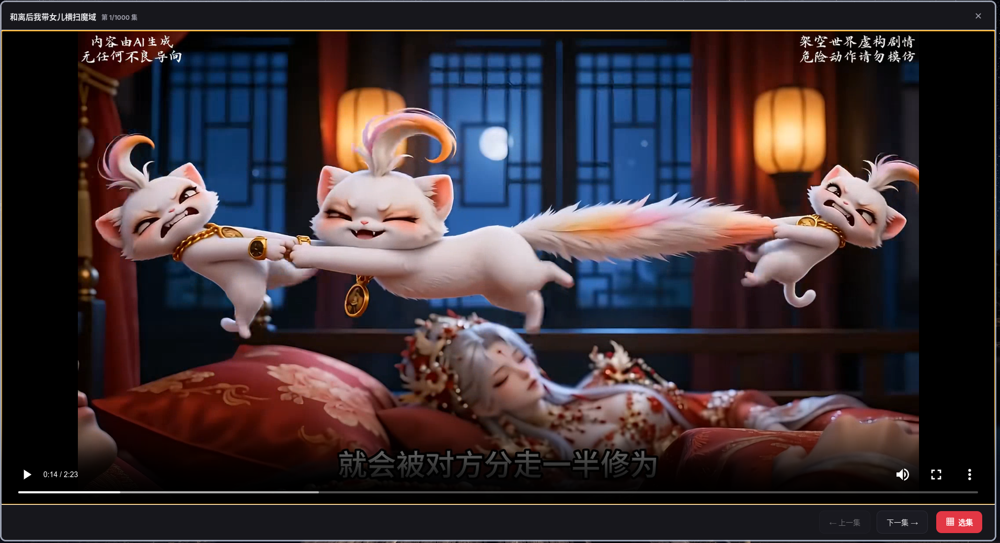

# hongguo-linux

红果短剧的 Linux 桌面学习客户端：Electron + HLS + 本地 unidbg 签名 harness。

> **本项目仅用于个人学习、逆向工程研究和本地互操作实验。**
> 不是红果/字节官方客户端，不提供账号、会员或付费内容绕过，也不保证长期可用。
> 使用前请阅读文末的[免责声明](#免责声明)和 [`NOTICE`](NOTICE)。

---

## 能做什么

- 推荐流、分类（真人剧 / 漫剧 / AI短剧）；
- 搜索：游客模式走官网网页公开搜索（无需凭证）；设备模式走站内接口搜索（需本地凭证，结果更全）；
- 1080p：解析 `video_model`，CENC `spade_a` 解密，H.264/HLS 播放；
- 竖滑预览：分类切换、预加载窗口、随机推送、本地去重；
- 剧集播放：上一集/下一集按同一部剧的剧集列表切换；
- Electron UI：推荐 / 分类 / 搜索 / 播放器，支持 Linux 打包。

## 界面预览

| 竖滑预览（默认漫剧，可切真人剧/AI短剧） | 分类浏览 |
|---|---|
|  |  |
| **搜索（游客模式走官网网页搜索）** | **播放器（选集 / 上一集 / 下一集）** |
|  |  |

---

## 环境要求

- Linux x86_64；
- Node.js 20+；
- Java 21（`javac` / `java`）；
- FFmpeg（开发时用系统 `ffmpeg`；打包时可用 `resources/ffmpeg`）。

> 公开仓库**不包含**红果 `.so`、签名 jar、ffmpeg、JRE。运行前需要从你自己
> 合法获得的 APK 中提取，见 [`vendor/README.md`](vendor/README.md)、
> [`signer/lib/README.md`](signer/lib/README.md)、[`resources/README.md`](resources/README.md)。

## 快速开始

```bash
npm install

# 1. 准备本地运行资源（不会下载/分发专有二进制）
APK=/path/to/com.phoenix.read_7.4.1.32.apk ./tools/build/setup-assets.sh
# 如果已有 unidbg-libs.jar：
# UNIDBG_LIBS_JAR=/path/to/unidbg-libs.jar ./tools/build/setup-assets.sh

# 2. 编译自写签名 harness
bash signer/build.sh

# 3. 启动 UI
npm run dev
```

> **没有本地凭证时默认游客模式**：推荐 / 分类 / 剧集 / 播放，以及搜索（走官网网页
> 公开搜索）都可用。想用站内接口搜索（设备模式）才需要在本地准备运行凭证。
>
> 本仓库和安装包都不包含任何账号或运行凭证，本文档也不提供获取或注册这些内容的方法。

## 搜索说明

应用分**游客模式**（默认，无需凭证）和**设备模式**（需本地凭证）两档，搜索来源不同：

- **游客模式搜索（网页）**：应用后台打开官方网页搜索页，读取官方网页自己的公开搜索结果，不需要设备身份；结果以普通卡片显示，点击后仍用 `episodes`/播放器 API 播放；
- **设备模式搜索（站内接口）**：走站内搜索接口，需要本地运行凭证，结果更全更准；
- 侧边栏的“网页搜”保留完整官网页面，作为手动入口。

网页搜索依赖官方页面和网络，不保证长期可用；页面改版后可能需要调整。

## 命令行

```bash
# 推荐（默认漫剧；可切真人剧/AI短剧）
node bin/hongguo.mjs feed --pages 1 --genre 真人剧

# 搜索
node bin/hongguo.mjs search "总裁" --pages 1

# 连续播放（mpv）
node bin/watch.mjs feed --limit 3
node bin/watch.mjs search "总裁" --limit 1

# 无显示器：只解码验证
node bin/watch.mjs feed --limit 1 --headless
```

## 目录结构

```text
hongguo-linux/
├─ bin/                 # CLI：feed / search / watch
├─ electron/            # Electron 主进程 + preload
├─ renderer/            # React + Vite UI
├─ services/
│  ├─ api.js            # 推荐 / 搜索 / 剧集 / video_model
│  ├─ media.js          # 下载 / CENC 解密 / H.264 HLS
│  ├─ hls_server.js     # 本地 HLS 服务
│  ├─ cover_server.js   # 封面代理（HEIC → JPEG）
│  └─ signer.js         # 启动 Java harness
├─ signer/              # 自写 Java harness
├─ tools/
│  ├─ build/            # 构建打包：build-linux / package / setup-assets / build-seed
│  ├─ release/          # 发布：publish-release.sh
│  ├─ device/           # 设备身份：identity / register*
│  ├─ test/             # 自测脚本
│  └─ decrypt/          # spade_a 解密
├─ release-notes/       # 各版本 release 说明（vX.Y.Z.md）
├─ vendor/              # unidbg 依赖说明
├─ resources/           # 打包用 ffmpeg / JRE 说明
├─ LICENSE              # 本项目原始代码 MIT
├─ NOTICE               # 第三方与专有文件说明
└─ LICENSES/            # 完整许可证文本
```

## 高级：本机自动注册

如果你有 KVM、Android SDK/emulator、AVD 和红果 APK，可以自动注册一套本地身份：

```bash
./tools/device/register-device.sh
```

脚本会检查环境、启动模拟器、注册并写入 AppImage 的用户数据目录。首次运行需要几分钟，
且必须有 `/dev/kvm`；没有 KVM 的机器不建议使用。

## 构建 / 打包

```bash
# 一键构建（会自动从本地私有资源目录恢复 .so/jar/ffmpeg）
./tools/build/build-linux.sh

# 只构建 AppImage（Arch / Ubuntu 通用）
TARGET=appimage ./tools/build/build-linux.sh

# 只构建 Ubuntu/Debian 的 deb
TARGET=deb ./tools/build/build-linux.sh

# 或者手动
npm run build:renderer
npm run dist
```

默认从 `../.private-assets/hongguo-linux` 读取本地资源；也可以：

```bash
ASSETS_DIR=/path/to/assets ./tools/build/build-linux.sh
APK=/path/to/app.apk UNIDBG_LIBS_JAR=/path/to/unidbg-libs.jar ./tools/build/build-linux.sh
```

产物：

```text
release/Hongguo-0.1.0.AppImage
release/Hongguo-0.1.0.deb
```

> AppImage 在 Arch / Ubuntu x86_64 上通用；极老的 Ubuntu（glibc 过旧）可能不兼容。

打包会使用：

- `resources/ffmpeg`（如果你本地准备了；GPLv3，见 `NOTICE`）；
- `resources/jre`（如果你本地准备了；jlink 裁剪）；
- `signer/out` + `signer/lib` + `vendor/unidbg-libs.jar`。

### 关于运行资源

公开仓库**不包含**以下文件：

- `signer/lib/*.so`、`signer/lib/*.bin`（红果专有）；
- `vendor/unidbg-libs.jar`（第三方依赖，需自行构建/获取）；
- `vendor/signer/sign/unidbg-sign.jar`（不需要，且许可证不明）；
- `resources/ffmpeg`（GPLv3 静态构建）；
- `resources/jre/`（jlink 运行时）。

获取方式：

```bash
# 从自己的 APK 提取 .so / ms_16777218.bin
APK=/path/to/app.apk ./tools/build/setup-assets.sh

# 已有 unidbg-libs.jar
UNIDBG_LIBS_JAR=/path/to/unidbg-libs.jar ./tools/build/setup-assets.sh
```

它们不适用本项目的 MIT 许可证；如果你在本地恢复这些文件，请遵守
[`NOTICE`](NOTICE) 与 [`LICENSES/`](LICENSES/README.md)。
**不要提交、不要公开分发。**

> 如果要公开到 GitHub，建议只发布源码。不要把包含 `.so` / `unidbg-libs.jar` /
> `ffmpeg` 的 AppImage 或 deb 上传到 Releases；那属于再分发第三方/专有二进制。

`npm run dist` 需要 `resources/ffmpeg` 和 `resources/jre/bin/java`；
缺失时请先按 [`resources/README.md`](resources/README.md) 准备。

---

## 本地数据

运行所需的本地凭证和缓存只保存在本机，不随仓库或安装包提供。

请勿把本地凭证、缓存或其他运行数据提交、截图、发群或上传网盘。

---

## 免责声明

**本项目仅用于个人学习、技术研究和本地互操作实验，不构成任何形式的授权、合作或官方支持。**

1. **非官方**：与字节跳动、红果短剧及其关联公司无任何隶属、授权或背书关系。
2. **不提供账号/会员/付费内容**：不包含登录、会员破解、付费内容绕过或商业分发功能。
3. **合法使用**：使用者应自行确保获取 APK、运行凭证、接口数据的方式合法，并遵守红果/字节的用户协议、robots 规则和当地法律法规。
4. **不得侵权**：不得将本项目用于侵犯著作权、商业秘密、商标权或其他权利；不得公开分发字节的 `.so`、凭证文件或其他专有材料。
5. **风险自担**：使用本项目可能导致账号/设备被风控、封禁、数据丢失或服务不可用；作者不对此承担责任。
6. **无保修**：软件按“现状”提供，不保证可用性、稳定性、安全性或适用于任何特定目的。
7. **API 变化**：红果接口、签名、加密随时可能变化，项目不保证持续维护或兼容。
8. **第三方许可证**：仓库内的第三方/专有文件按其自身许可证或“无授权”状态处理，详见 `NOTICE`；本项目 MIT 许可证不覆盖它们。
9. **删除请求**：如果你是权利人并认为某文件侵权，请提出，仓库维护者应尽快核查并移除。

> 如果你不接受以上条款，请不要使用或分发本项目。

---

## 许可证

- **本项目原始代码**：MIT，见 [`LICENSE`](LICENSE)；
- **第三方组件**：见 [`NOTICE`](NOTICE) 和 [`LICENSES/`](LICENSES/README.md)；
- **ByteDance / Hongguo 专有二进制**：不授予任何权利，禁止公开再分发。

## 致谢

- [unidbg](https://github.com/zhkl0228/unidbg)：本地 native 调用框架；
- FFmpeg、Capstone、Unicorn、Keystone、JNA、SLF4J 等开源项目；
- 以及所有参与逆向、协议分析和测试的研究者。
